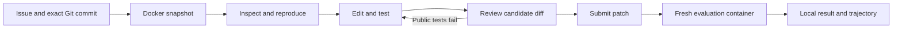

# Local issue-solving workflow

`./gemma-lab demo --model e4b` exercises the whole local workflow with a synthetic
URL-query issue. This is not an official competition evaluation.

The model runs on the existing vLLM endpoint; tools run in an isolated Docker container.
The loop logs every response and tool result, caps turns/time/tool calls, and drops
complete old conversation groups when the configured history size is reached.



The model chooses inspection, reproduction and editing actions. The host controls
time/tool budgets and submission checks. By default, the first submission request
triggers an explicit review; later requests must include a changed regression-test
file and pass the repository's configured public test command. These checks improve
iteration discipline; passing public tests alone does not establish correctness.
A patch with weakened tests can still be rejected by independent evaluation.

## Commands

```bash
docker build -t gemma-lab-sandbox:local docker/local
./gemma-lab demo --model e4b
# Once official public tasks and a matching local checkout are available:
./gemma-lab solve --repo requests --task INSTANCE_ID --checkout /path/to/requests
```

`solve` uses local tools and saves a submitted patch; it does not run a hidden evaluator.
`run` invokes the configured official harness. `demo` evaluates its patch using a
fresh container and separate held-out checks stored under `examples/evaluation/`.
Those files are never copied into the agent's sandbox or fed back to the agent.
The demo first runs the same held-out checks on the unmodified baseline to show that
the evaluator can detect the original bug.

## Changing repositories

Set each repository's `test_command` in `configs/project.toml`. Prepare a sandbox
image with that repository's required dependencies installed ahead of time, then set
`workflow.image`. The generic example image only contains Python, Git and Bash;
it is sufficient for URLKit, not for the full dependency stacks of competition repos.
The current local checkout exporter accepts full 40-character commit SHAs and
rejects repository symlinks and device files. No untracked host files are exported.

## Artifacts

Each run saves `manifest.json`, `agent_input.json`, `trajectory.jsonl`, candidate and
submitted diffs, public-test results and (for the demo) independent evaluation output.
Runtime responses include token usage. All artifacts are under ignored `runs/`.
The temporary demo source checkout and all containers are removed after the run.

## Boundaries

The container has no network, host mounts, Docker socket, extra Linux capabilities
or writable host root filesystem. It uses a non-root user, temporary writable
workspace, memory/CPU/PID limits, and command timeouts. File tools reject traversal
outside `/workspace`; shell commands can read the container's own filesystem.
Only the trusted orchestration process communicates with vLLM and Docker.

This local tool loop uses the basic competition tool names as a development adapter.
It is not the official Google ADK compiler and does not establish agent.yaml validity,
competition budget parity, or leaderboard performance. The official adapter still
requires the supplied sample/config schema and harness wheels. Graph retrieval,
LoRA and sub-agent YAML are not implemented by the local runner yet.
